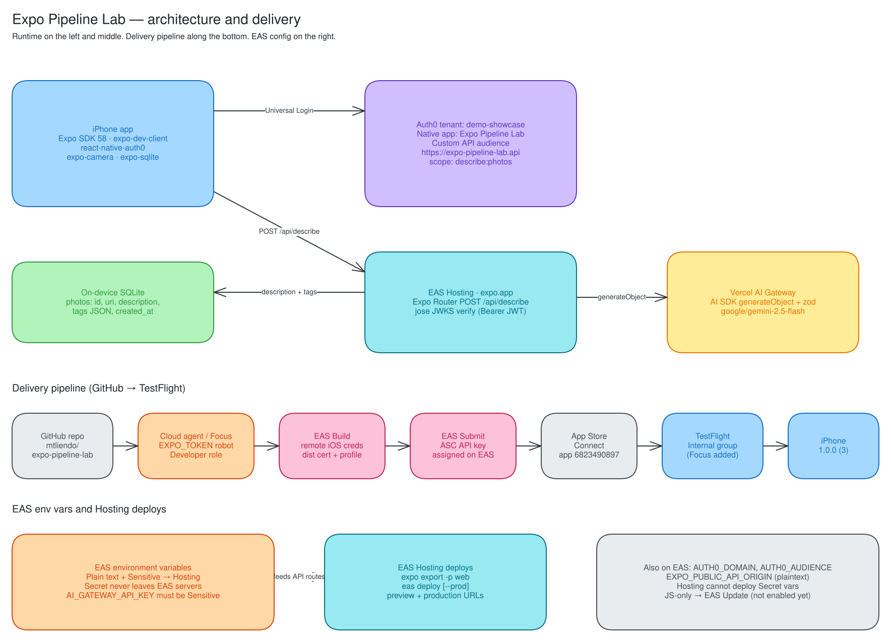

# Expo + Auth0 + EAS pipeline — learnings for Focus

Reusable reference after we proved this lab end to end on TestFlight **1.0.0 (3)**: Auth0 sign-in on a physical iPhone, camera capture, photo sent to the Auth0-protected Expo API route on EAS Hosting, AI description + tags returned, saved locally in `expo-sqlite`.

This is a lab, not a product. Keep the next app just as small until the pipeline is green.



Editable source: [`architecture.excalidraw`](./architecture.excalidraw) (open at [excalidraw.com](https://excalidraw.com)). Regenerated by [`scripts/diagram/`](../scripts/diagram/README.md).

---

## What we built and how the pipeline works

The iOS app is Expo SDK 58 with a development client (not Expo Go). It signs in with `react-native-auth0`, takes a photo with `expo-camera`, POSTs the JPEG as base64 to `POST /api/describe`, and stores `{id, uri, description, tags, created_at}` in `expo-sqlite`.

| Piece | What it is in this repo |
| --- | --- |
| iPhone app | Expo SDK 58, `expo-dev-client`, `react-native-auth0` 5.11.2, `expo-camera`, `expo-sqlite`. Bundle ID `com.focusotter.expopipelinelab`, scheme `expopipelinelab`. |
| Auth0 tenant | `demo-showcase`. Native app **Expo Pipeline Lab** (client ID `mw7slVl0xn16xgjCLPEN9D3eYk9FqVA5`). Custom API **Expo Pipeline Lab API**, audience `https://expo-pipeline-lab.api`, scope `describe:photos`. |
| EAS Hosting | Expo Router API route `src/app/api/describe+api.ts`. `web.output = "server"`. Production URL `https://expo-pipeline-lab.expo.app`. |
| Token check | `jose` `createRemoteJWKSet` + `jwtVerify` against the tenant JWKS, issuer, and API audience (`src/lib/auth.ts`). Bearer JWT, not DPoP (`useDPoP={false}`). |
| AI | Vercel AI Gateway via AI SDK `generateObject` + Zod (`src/lib/schema.ts`). Default model `google/gemini-2.5-flash`. |
| Local store | `expo-sqlite` database `pipeline-lab.db`, table `photos`. |
| EAS project | `@focus-otter/expo-pipeline-lab`, project ID `87c2f5aa-04a4-4716-a566-0d2a57bc2992`. |
| Store record | App Store Connect Apple ID `6823490897` in `eas.json` at `submit.production.ios.ascAppId`. |

Runtime path:

1. `authorize({ scope: 'openid profile email offline_access describe:photos', audience }, { customScheme })` opens Auth0 Universal Login and returns an access token for the custom API.
2. Camera captures a JPEG (`quality: 0.4`, `base64: true`).
3. The app `fetch`es `EXPO_PUBLIC_API_ORIGIN + /api/describe` with `Authorization: Bearer <access token>`.
4. The Hosting route verifies the JWT, then calls `generateObject`. On success it returns `{ description, tags }`.
5. The app inserts the local photo URI plus that JSON into SQLite and shows it on the list screen.

Delivery path:

1. GitHub repo `mtliendo/expo-pipeline-lab`.
2. A cloud agent or Focus, authenticated as the Expo robot user via `EXPO_TOKEN` (Developer on the `focus-otter` org).
3. `eas build -p ios --profile production` using **remote** iOS credentials (distribution cert + provisioning profile).
4. `eas submit -p ios --profile production --latest` using an App Store Connect API key **assigned on EAS**.
5. App Store Connect processes the IPA.
6. An Internal Testing group (with Focus added) makes the build appear in TestFlight on the phone.

Hosting deploys are a separate command: `pnpm exec expo export -p web` then `pnpm exec eas-cli deploy` (add `--prod` for the production alias). They pick up **Plain text** and **Sensitive** EAS env vars only.

Verified on device after Focus finished the first interactive submit: TestFlight **1.0.0 (3)**. Agents built that binary and hosted the API; they did not complete submit themselves.

---

## Learnings / gotchas we actually hit

Each item below is checked against this repo (including the PR #1 / EAS-setup agent history) and against current docs.

### 1. EAS Hosting never receives Secret env vars

**What happened:** The first Hosting deploy stored `AI_GATEWAY_API_KEY` as **Secret**. Authenticated `POST /api/describe` returned **500** `Unauthenticated request to AI Gateway`. After Focus recreated the same key as **Sensitive** and we redeployed, the route returned **200** with a description and 3–5 tags.

**Why:** EAS has three visibilities. Secret values never leave EAS build/workflow machines. `eas deploy --environment …` only injects Plain text and Sensitive into API routes. Secret is for things like `NPM_TOKEN` during `eas build`, not for Hosting.

**Rule:** Server keys used by API routes (`AI_GATEWAY_API_KEY`, future `DATABASE_URL`, Stripe secrets) must be **Sensitive**. Never prefix them `EXPO_PUBLIC_`. Public Auth0 identifiers can be Plain text.

Docs: [Environment variables in EAS](https://docs.expo.dev/eas/environment-variables/), [What every dev should know about environment variables](https://expo.dev/blog/what-are-environment-variables).

### 2. `react-native-auth0` 5.11.2 on SDK 58 broke the iOS build

**What happened:** Production build 1.0.0 (1) failed with:

`AppDelegate.swift: method does not override any method from its superclass`

The Auth0 config plugin injects `override application(_:open:options:)` by anchoring on `sourceURL(for:)`. On SDK 58 that method lives on `ReactNativeDelegate`, not `AppDelegate`. SDK 58 is scene-based; `ExpoAppSceneDelegate` already forwards open-URL events to `RCTLinkingManager`.

**Fix in this repo:** [`plugins/withAuth0Expo58AppDelegate.js`](../plugins/withAuth0Expo58AppDelegate.js), registered last in `app.config.ts`. It strips the `@generated begin/end react-native-auth0-linking-swift` block after the Auth0 plugin writes it. Build 1.0.0 (2) then finished.

Do not “fix” this by pinning an older Auth0 SDK unless you have tested that version on SDK 58. Check whether a later `react-native-auth0` release has landed a native SDK 58 plugin before copying this workaround to a new app.

### 3. `expo-sqlite` web export needs `wasm` in Metro `assetExts`

**What happened:** `expo export -p web` (required for Hosting) failed because Metro did not treat `wa-sqlite.wasm` as an asset.

**Fix:** [`metro.config.js`](../metro.config.js) pushes `wasm` onto `resolver.assetExts`. That matches current Expo SQLite web setup.

Docs: [Expo SQLite — Web setup](https://docs.expo.dev/versions/latest/sdk/sqlite/). If you actually serve the SQLite web client, you also need COOP/COEP headers for `SharedArrayBuffer`. This lab only needed the wasm asset so the Hosting export would succeed; the iPhone app does not use the wasm build.

### 4. `ascAppId` belongs at `submit.production.ios.ascAppId` (EAS CLI 25)

**What happened:** First submit failed with `Set ascAppId in the submit profile (eas.json) or re-run this command in interactive mode.` Putting `ascAppId` on `submit.production` (no `ios` wrapper) was rejected by **eas-cli 25**. Nesting it under `ios` fixed the schema.

```json
{
  "submit": {
    "production": {
      "ios": {
        "ascAppId": "6823490897"
      }
    }
  }
}
```

Docs: [Submit to the Apple App Store](https://docs.expo.dev/submit/ios/), [Configure EAS Submit with eas.json](https://docs.expo.dev/submit/eas-json), [eas.json reference](https://docs.expo.dev/eas/json/).

### 5. `ITSAppUsesNonExemptEncryption=false` skips the export-compliance prompt

`app.json` sets `ios.infoPlist.ITSAppUsesNonExemptEncryption` to `false`. That is the standard way to tell App Store Connect the app uses no encryption, or only exempt encryption (HTTPS counts as exempt for typical apps). Without the key, ASC asks the questionnaire on every upload.

We set this before TestFlight. Confirm in ASC that a new build does not sit in **Missing Compliance**. If the app later adds non-exempt crypto, change the flag and follow Apple’s documentation flow instead.

Docs: [Overview of export compliance](https://developer.apple.com/help/app-store-connect/manage-app-information/overview-of-export-compliance/), [Provide export compliance for beta builds](https://developer.apple.com/help/app-store-connect/test-a-beta-version/provide-export-compliance-information-for-beta-builds/).

### 6. ASC API keys cannot be created in `--non-interactive` mode

**What happened:** After `ascAppId` was nested, `eas submit --non-interactive` failed with:

`App Store Connect API Keys cannot be set up in --non-interactive mode.`

Focus ran `eas submit` **interactively once**, reused an existing ASC API key, and assigned it on EAS. Later agent submits can be `--non-interactive`.

Docs: [Submit iOS — non-interactive / CI](https://docs.expo.dev/submit/ios/) (same error string). Interactive path: `eas credentials -p ios` → production profile → App Store Connect API Key → set up for EAS Submit. Or pass `ascApiKeyPath` / `ascApiKeyIssuerId` / `ascApiKeyId` in `eas.json` (never commit the `.p8`).

### 7. Expo robot users can build and submit; they cannot upload project icons

`eas whoami` during the pipeline work: `cursor-cloud-agent (robot)` on account `focus-otter`, **Developer** role, `EXPO_TOKEN`.

The robot could `eas init`, `eas env:set` (public vars), `eas deploy`, and `eas build` with remote credentials. It could **not** set the EAS dashboard project icon (`ProfileImageUploadSessionEntity` create denied for `RobotViewerContext`). Focus uploads icons in the website or with a human token.

Robots cannot sign in to expo.dev. They only work via access tokens. Developer can create projects, build, release updates, and manage credentials. Icon / some dashboard settings stay with Admin/Owner or a human session.

Docs: [Programmatic access](https://docs.expo.dev/accounts/programmatic-access/), [Account types](https://docs.expo.dev/accounts/account-types/).

### 8. A new ASC app needs an Internal Testing group (with you in it)

Agents never uploaded to TestFlight, so this is the human step Focus completed after submit. A build in App Store Connect is not the same as a build on your phone. TestFlight only shows builds assigned to a group you belong to.

Create **Internal Testing** → add yourself (the Apple ID signed into TestFlight on the phone) → assign the build or enable automatic distribution. Internal testers are ASC users (Account Holder, Admin, App Manager, Developer, Marketing), up to 100, no Beta App Review.

Docs: [Add internal testers](https://developer.apple.com/help/app-store-connect/test-a-beta-version/add-internal-testers), [TestFlight](https://developer.apple.com/testflight/).

### 9. Bundle ID + ASC app record are one-time Apple-portal work

EAS will not invent these. Register `com.focusotter.expopipelinelab` under Certificates, Identifiers & Profiles, then create the App Store Connect app with that bundle ID. The numeric Apple ID (`6823490897`) is what `ascAppId` needs. Agents can consume the ID; they should not guess it.

### 10. Auth0 Native app: callback format, audience, scope, consent

**Callback / logout URL we registered** (custom scheme `expopipelinelab`):

`expopipelinelab://<demo-showcase-domain>/ios/com.focusotter.expopipelinelab/callback`

Format: `{customScheme}://{domain}/ios/{bundleIdentifier}/callback`. The path is the **bundle ID**, not the scheme. All lowercase, no trailing slash. The same URL is an Allowed Logout URL. Pass `{ customScheme: 'expopipelinelab' }` to both `authorize` and `clearSession`.

If you omit `customScheme`, the SDK defaults to `{bundleId}.auth0://…`.

Docs: [Auth0 Expo quickstart](https://auth0.com/docs/quickstart/native/react-native-expo), [react-native-auth0](https://auth0.github.io/react-native-auth0/).

**Audience + scope:** `authorize` requests `audience: https://expo-pipeline-lab.api` and `describe:photos` plus OIDC scopes. The API route checks issuer + audience. A token without that audience is a 401. First-party Native apps need a client grant on the API.

**Consent / confirmation:**

- First-party apps can skip the API consent dialog if the API has **Allow Skipping User Consent** enabled ([user consent](https://auth0.com/docs/get-started/applications/third-party-applications/user-consent-and-third-party-applications)). Third-party apps always show it.
- A **custom URI scheme is a non-verifiable callback**. Auth0 may still show a “confirm this app” prompt even when API consent is skipped ([application impersonation](https://auth0.com/docs/secure/security-guidance/measures-against-app-impersonation)). Universal Links (`https://{domain}/ios/{bundleId}/callback`) avoid that. We used a custom scheme for this lab.
- Live Universal Login UX was verified on device by Focus, not in the agent transcripts. Do not assume consent is hidden until you try it on a phone.

DPoP stays off here because the API verifies a Bearer JWT with `jose`, not a DPoP proof.

---

## How well this scales

### One-time per Apple / Expo account

| Item | Who | Reuse |
| --- | --- | --- |
| Apple Developer Program membership | Focus (2FA, paid team) | All apps on that team |
| Expo org (`focus-otter`) + billing plan | Focus | All EAS projects |
| Robot user + `EXPO_TOKEN` (Developer) | Focus creates; agents use | All projects the robot can see |
| Distribution certificate | First interactive `eas build` / `eas credentials` | **Reuse across apps on the same team** |
| App Store Connect API key, assigned on EAS | Focus, once interactively | **Reuse across apps** once connected |
| Auth0 tenant (`demo-showcase`) + CLI login | Focus / Auth0 | Many Native apps + APIs in one tenant |

### One-time per app

| Item | Who |
| --- | --- |
| Bundle ID in Apple Identifiers | Focus |
| ASC app record + numeric Apple ID | Focus |
| Auth0 Native application + callback/logout URLs | Agent via Auth0 CLI, or Focus |
| Auth0 API (audience) + scopes + client grant | Agent via Auth0 CLI, or Focus |
| `eas init`, `eas.json` profiles, `app.json` plugins | Agent |
| EAS env vars with the right visibility | Agent for public; Focus for secret *values* you do not want in the agent log, set as **Sensitive** |
| First Hosting deploy + production alias | Agent |
| Internal Testing group + add yourself | Focus |
| Optional: project icon on expo.dev | Focus (robots cannot) |

### Per build / per deploy

| Item | Cost / limit notes |
| --- | --- |
| `eas build -p ios` | Free plan: 15 iOS + 15 Android / month, low-priority queue, 45 min timeout. Paid plans use build **credits** then a flat fee: iOS medium **$2**, iOS large **$4** ([EAS pricing](https://expo.dev/pricing)). |
| `eas submit` | Included on every plan. Still needs the ASC key + `ascAppId`. |
| `eas deploy` (Hosting) | 100k requests / 1M CPU-ms / 1 GB storage included on all plans. Free: 10 CPU-ms per request, 5 aliases, 7-day logs, 30-day preview retention. Paid: higher per-request CPU, custom domain, longer retention. Overage on paid: $2 / 1M requests, $0.04 / 1M CPU-ms. |
| AI Gateway | No markup on provider token prices. Free tier is rate-limited per model (`429`). Paid credits remove Gateway’s own limits; provider limits still apply. Set a budget. ([AI Gateway pricing](https://vercel.com/docs/ai-gateway/pricing), [rate limits](https://vercel.com/docs/ai-gateway/rate-limits)). |
| EAS Update (not enabled yet) | Free: 1k MAUs. Starter 3k then usage. Production 50k then usage. |

### What agents can do vs what Focus must do

**Agents (robot + Auth0 CLI + repo access):** scaffold the Expo app, Auth0 Native app + API + grant, EAS project link, public/Sensitive env *names*, Hosting deploys, production iOS builds once credentials exist, non-interactive submit once the ASC key is assigned, docs, PRs.

**Focus (Apple portal, 2FA, interactive, money):** Apple membership, bundle ID, ASC app, first distribution cert / profile if EAS cannot create them non-interactively, first ASC API key assignment, Internal Testing group, TestFlight install, robot token + org role, any dashboard icon, paid plan upgrades, App Store **review** (this lab never submits for review).

### Team scaling

- One robot per org is enough if its role covers build/submit. Prefer Developer, not Owner.
- Do not put `AI_GATEWAY_API_KEY` in the agent chat. Focus sets Sensitive vars in the EAS UI or `eas env:create` locally.
- Reuse the dist cert and ASC key. New apps still need a new bundle ID, ASC record, Auth0 application, and Internal group.
- For several engineers: add them as Internal testers (ASC users) or use External Testing (Beta App Review).
- `EXPO_TOKEN` in cloud-agent secrets beats `eas login` on a headless VM.

---

## Playbook for the next app

Numbered path from zero to TestFlight, reusing this account setup. Do not submit for App Store review unless a human explicitly asks.

1. **Confirm the account layer is already done:** Apple team, Expo org, robot `EXPO_TOKEN`, distribution cert on EAS, ASC API key assigned on EAS, Auth0 tenant + CLI.
2. **Pick identifiers:** bundle ID, URL scheme (lowercase, no special characters), Auth0 app name, API audience (`https://<app>.api`), one custom scope.
3. **Apple portals (Focus, once):** register the bundle ID; create the ASC app; copy the numeric Apple ID.
4. **Auth0 CLI:** create a Native application; set Allowed Callback/Logout URLs to `{scheme}://{domain}/ios/{bundleId}/callback`; create the API with that audience; add the scope; create a client grant from the Native app to the API; enable the DB connection on the client. Optionally enable **Allow Skipping User Consent** on the API.
5. **Expo app:** SDK 58 + `expo-dev-client` + `expo-router` (`web.output: "server"`) + Auth0 plugin (`domain`, `customScheme`) + camera/sqlite plugins as needed. Copy `plugins/withAuth0Expo58AppDelegate.js` until Auth0 ships an SDK 58-safe plugin. Set `ITSAppUsesNonExemptEncryption: false` if the exemption still applies.
6. **`metro.config.js`:** add `wasm` to `assetExts` if `expo-sqlite` is in the web export.
7. **`eas init`** as the robot (`--non-interactive --force` if `projectId` is missing).
8. **`eas.json`:** `development` / `preview` / `production` build profiles; `submit.production.ios.ascAppId`.
9. **EAS env vars:** Plain text for `AUTH0_DOMAIN`, `AUTH0_AUDIENCE`, `EXPO_PUBLIC_API_ORIGIN`. **Sensitive** for `AI_GATEWAY_API_KEY` and any other server key. Never Secret for Hosting.
10. **Hosting:** `expo export -p web` && `eas deploy` then `eas deploy --prod`. Smoke-test `POST /api/describe` → 401 without a token. Use an M2M test app if you need a 200 before the iPhone is ready.
11. **iOS build:** `eas build -p ios --profile production --non-interactive`. If Auth0 AppDelegate fails, confirm the strip plugin is last in `app.config.ts`.
12. **Submit:** `eas submit -p ios --profile production --latest --non-interactive`. If you see the ASC API key error, Focus runs submit interactively once and assigns the existing key.
13. **TestFlight:** wait for processing; answer compliance only if the plist flag was omitted; Internal group + add yourself; install on the phone.
14. **Device check:** Auth0 login, camera, API, SQLite row. Only then add features.

---

## Adding common features

**The rule:** any change to native code, config plugins, `app.json` native fields, permissions, entitlements, or adding a native module = **new native build**. JS/assets-only = **EAS Update** (after Update is enabled). API-route-only = **EAS Hosting deploy**, no app update.

This repo does **not** have `expo-updates`. There is no `runtimeVersion` and no `channel` in `eas.json`. Failed-build metadata from the first iOS build had `"runtimeVersion": null`. **EAS Update needs one more native build** after you run `eas update:configure` (installs `expo-updates`, writes `runtimeVersion` + `updates.url`, sets channels on build profiles). Do not configure that in this docs PR.

**Recommended `runtimeVersion` policy:** `{ "policy": "appVersion" }`. That is what `eas update:configure` writes and what Expo still recommends so each store version (`1.0.0`) is a unique native runtime. Bump `expo.version` when you change native code. SDK 58 improved fingerprinting (`balanced` preset), but Expo still calls `fingerprint` a future/experimental alternative, not the default recommendation. ([Get started with EAS Update](https://docs.expo.dev/eas-update/getting-started/), [Deploy updates](https://docs.expo.dev/eas-update/deployment/), [Runtime versions](https://docs.expo.dev/eas-update/runtime-versions/).)

### Stripe payments

**Involves:** `@stripe/stripe-react-native` (or Payment Sheet) on device; PaymentIntent / Checkout on an API route; Apple Pay entitlement if you use it.

**Native?** Yes, for a native Payment Sheet. Hosting-only Checkout / Payment Links can work with `Linking` if you stay inside Apple’s rules.

**New build?** Yes if you add the Stripe native module or Apple Pay entitlement.

**Apple’s rule:** digital goods, subscriptions, and in-app features generally require **In-App Purchase**, not Stripe ([Guideline 3.1.1](https://developer.apple.com/app-store/review/guidelines/)). Physical goods and services consumed **outside** the app **must** use a non-IAP processor such as Stripe / Apple Pay ([3.1.3(e)](https://developer.apple.com/app-store/review/guidelines/)). Do not unlock Pro features in this lab via Stripe. US / some storefronts have extra external-purchase link entitlements; do not rely on that for a first version.

### Subscriptions via RevenueCat

**Involves:** `react-native-purchases` (+ optional `react-native-purchases-ui`), RevenueCat project + Apple app, ASC subscription group + products, Paid Applications agreement, sandbox testers.

**Native?** Yes. Expo Go cannot complete real purchases.

**New build?** Yes.

**Notes:** Create products in App Store Connect, attach them to a RevenueCat entitlement, configure the iOS public SDK key, and test with a sandbox Apple ID ([RevenueCat Expo install](https://www.revenuecat.com/docs/getting-started/installation/expo), [Apple sandbox](https://www.revenuecat.com/docs/test-and-launch/sandbox/apple-app-store)). TestFlight purchases show on RevenueCat’s production view, not sandbox. Server-side receipt checks can live on Hosting; the StoreKit bit cannot.

### Neon Postgres

**Involves:** `@neondatabase/serverless` (or Drizzle `neon-http`) inside `+api.ts`. `DATABASE_URL` as **Sensitive**. Never `EXPO_PUBLIC_`.

**Native?** No.

**New build?** No. Hosting deploy only.

**Sync with SQLite:** keep `expo-sqlite` as the offline cache. API routes own the source of truth. Pull/push from the app over the existing Auth0 Bearer token. Use Neon’s pooled (`-pooler`) connection for the route; use a direct connection for migrations. ([Neon + Drizzle](https://neon.com/docs/guides/drizzle).)

### Push notifications

**Involves:** `expo-notifications`, APNs key (EAS can generate on first credentials prompt), `aps-environment` entitlement, usage description if you request permission.

**Native?** Yes.

**New build?** Yes. The plugin’s `enableRemoteNotifications` / background modes cannot ship over Update. ([Push notifications setup](https://docs.expo.dev/push-notifications/push-notifications-setup/), [expo-notifications](https://docs.expo.dev/versions/latest/sdk/notifications/).)

Notification **content** and Hosting-triggered sends can change without a build.

### Apple Calendar writes

**Involves:** `expo-calendar`, `NSCalendarsWriteOnlyAccessUsageDescription` / full-access strings, config plugin.

**Native?** Yes.

**New build?** Yes. Permission strings are Info.plist. ([expo-calendar](https://docs.expo.dev/versions/latest/sdk/calendar/).)

### Sign in with Apple

**Involves:** `expo-apple-authentication`, `ios.usesAppleSignIn: true`, `com.apple.developer.applesignin` entitlement. Can sit beside Auth0 (Auth0 social connection) or replace Username-Password for the demo.

**Native?** Yes.

**New build?** Yes. ([expo-apple-authentication](https://docs.expo.dev/versions/latest/sdk/apple-authentication/).)

### Deep links / Universal Links

**Involves:** `expo-linking` / Expo Router already present. Custom scheme is already `expopipelinelab`. Universal Links need `ios.associatedDomains` and an Apple App Site Association file (Auth0 can serve `https://{domain}/ios/{bundleId}/callback`).

**Native?** Associated domains / new URL types = yes. Extra JS routes only = no.

**New build?** Yes for associated domains or a new scheme. JS route handling can be Update.

### Background tasks

**Involves:** `expo-background-task` / `expo-task-manager`, `UIBackgroundModes` in Info.plist.

**Native?** Yes.

**New build?** Yes.

### Location

**Involves:** `expo-location`, When-In-Use / Always usage strings, optional background location entitlement.

**Native?** Yes.

**New build?** Yes.

### File / media uploads to storage

**Involves:** pick with `expo-image-picker` (already have camera), upload from the API route to S3 / Neon Object Storage / Vercel Blob. Prefer: device → Auth0-protected route → storage. Do not put storage credentials in the app.

**Native?** Picker/camera already native. New storage SDK on device only if you skip the route.

**New build?** No if you only add a Hosting upload route and reuse the existing camera photo. Yes if you add a new picker/filesystem module.

### Analytics / crash reporting (Sentry)

**Involves:** `@sentry/react-native` + Expo plugin, auth token as Sensitive/CI secret, source maps on EAS Build/Update.

**Native?** Yes (native crash pipeline).

**New build?** Yes for the first add. Later JS-only instrumentation can be Update.

### Widgets / Live Activities

**Involves:** `expo-widgets` (stable as of SDK 56+), Widget Extension target via CNG, App Group, APNs for Live Activity updates.

**Native?** Yes (extension + entitlements).

**New build?** Yes. ([expo-widgets](https://docs.expo.dev/versions/latest/sdk/widgets/), [SDK 56 widgets post](https://expo.dev/blog/ios-widgets-and-live-activities-in-expo).) Confirm SDK 58 package availability before depending on it.

### Biometrics / SecureStore

**Involves:** `expo-secure-store` for the refresh token, `expo-local-authentication` for Face ID / Touch ID. `NSFaceIDUsageDescription` for Face ID.

**Native?** Yes.

**New build?** Yes when adding the modules or Face ID string. Reading/writing keys in JS after that can be Update.

### Auth0 Token Vault

**Involves:** store third-party tokens (Google, Microsoft, …) in Auth0; exchange an Auth0 refresh/access token on a **confidential** backend. Good fit for “upload this photo to Google Photos” without shipping a Google refresh token on the phone.

**Native?** No extra native module if you already have Auth0. Token exchange belongs on the Hosting route (confidential client / Custom API Client). Native apps are public clients — do not put a client secret in the IPA.

**New build?** No for the Hosting exchange. Yes if you add a new social connection that needs a new callback / associated domain.

Docs: [Token Vault](https://auth0.com/docs/secure/call-apis-on-users-behalf/token-vault), [Refresh token exchange](https://auth0.com/docs/secure/call-apis-on-users-behalf/token-vault/refresh-token-exchange-with-token-vault).

### Auth0 MFA

**Involves:** tenant MFA policy (always / adaptive), Guardian / OTP / email. Universal Login hosts the challenge; `react-native-auth0` already opens that browser/session.

**Native?** Not a new native module.

**New build?** No, unless you add a custom MFA UX SDK or Associated Domains. Enable MFA in the `demo-showcase` tenant (Focus) and re-test login on the existing TestFlight build.

### Summary table

| Feature | Native code? | New build? | EAS Update OK? | Server/Hosting only? | Notes |
| --- | --- | --- | --- | --- | --- |
| Stripe (physical / out-of-app) | Usually yes (Payment Sheet) | Yes if native SDK | After first build, JS-only tweaks | Checkout/Payment Links can be Hosting | Forbidden for digital IAP-class goods ([3.1.1](https://developer.apple.com/app-store/review/guidelines/)) |
| Stripe (digital goods) | Prefer StoreKit, not Stripe | Yes (IAP) | No for StoreKit | Webhooks on Hosting | Use RevenueCat / IAP |
| RevenueCat subscriptions | Yes (`react-native-purchases`) | Yes | No for first add | Webhooks / entitlements on Hosting | ASC products, agreements, sandbox testers |
| Neon Postgres | No | No | n/a | **Yes** | Sensitive `DATABASE_URL`; sync with SQLite over API |
| Push notifications | Yes | Yes | Payload / server send only | Expo Push / APNs from Hosting | APNs key + entitlement |
| Calendar writes | Yes | Yes | After first build, JS event logic | No | Info.plist usage strings |
| Sign in with Apple | Yes | Yes | No for entitlement | Auth0 connection config is tenant-side | `usesAppleSignIn` |
| Deep links / Universal Links | Associated domains = yes | Yes for domains/schemes | JS routers yes | AASA can live on Auth0 / Hosting | Path is bundle ID, not scheme |
| Background tasks | Yes | Yes | No | No | `UIBackgroundModes` |
| Location | Yes | Yes | After first build, JS geofence logic | No | Usage strings + optional Always |
| Uploads to storage | Only if new picker | No if reuse camera + route | JS client yes | **Preferred** | Never ship storage keys |
| Sentry | Yes | Yes first time | Later JS-only | Source maps on Build/Update | Plugin + auth token |
| Widgets / Live Activities | Yes (extension) | Yes | Widget JS bundle is still a native target | APNs updates from Hosting | `expo-widgets` |
| Biometrics / SecureStore | Yes | Yes first time | Later JS yes | No | Face ID usage string |
| Auth0 Token Vault | No new module | No | n/a | **Yes** (token exchange) | Confidential backend; not the Native app secret |
| Auth0 MFA | No | No | n/a | Tenant policy | Existing Universal Login |

---

## Current Update / runtime state (do not configure in this PR)

Checked in `package.json` / `app.json` / `eas.json`:

- `expo-updates` is **not** installed.
- No `expo.runtimeVersion`.
- No `expo.updates.url`.
- No `channel` on build profiles.

To turn on EAS Update later:

1. `pnpm exec expo install expo-updates`
2. `pnpm exec eas-cli update:configure` → expect `"runtimeVersion": { "policy": "appVersion" }` and channels on `preview` / `production`.
3. **Ship a new iOS build.** Existing TestFlight 1.0.0 (3) will not load updates.
4. Publish with `eas update --channel production --message "…" --environment production`.

Until that build exists, JS-only fixes still require a full EAS Build + Submit, or a development build + Metro.

---

## Sources (short list)

- This repo: `README.md`, `app.json`, `app.config.ts`, `eas.json`, `metro.config.js`, `plugins/withAuth0Expo58AppDelegate.js`, `src/app/api/describe+api.ts`, `src/lib/auth.ts`.
- PR #1 merge commit and the EAS-setup agent run that produced builds 1–3 and the Secret→Sensitive Hosting 500.
- [EAS env vars](https://docs.expo.dev/eas/environment-variables/), [EAS Submit iOS](https://docs.expo.dev/submit/ios/), [EAS Update get started](https://docs.expo.dev/eas-update/getting-started/), [EAS pricing](https://expo.dev/pricing).
- [Auth0 Expo QS](https://auth0.com/docs/quickstart/native/react-native-expo), [consent](https://auth0.com/docs/get-started/applications/third-party-applications/user-consent-and-third-party-applications), [Token Vault](https://auth0.com/docs/secure/call-apis-on-users-behalf/token-vault).
- [App Review Guidelines](https://developer.apple.com/app-store/review/guidelines/), [TestFlight internal testers](https://developer.apple.com/help/app-store-connect/test-a-beta-version/add-internal-testers).
- [RevenueCat Expo](https://www.revenuecat.com/docs/getting-started/installation/expo), [AI Gateway pricing](https://vercel.com/docs/ai-gateway/pricing), [Neon Drizzle](https://neon.com/docs/guides/drizzle).
